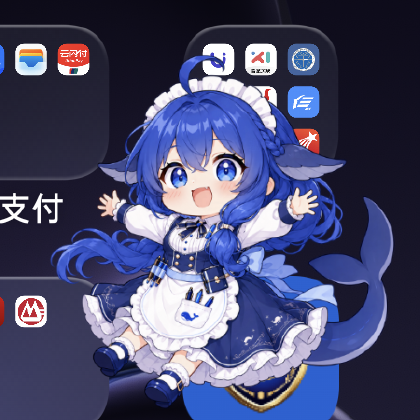

# 小鲸鱼 · WhalePet

一只住在安卓悬浮窗里的蓝发鲸鱼娘。她会回应你的触摸、会饿会困、会自己游来游去，
状态还能跨重启保留 —— 而且**可以和她说话**。



> 上图是真机截图：小鲸鱼作为系统悬浮窗浮在桌面之上，不依赖任何宿主应用。

---

## 这是什么

一个**系统级悬浮宠物**。不是网页里 `position: fixed` 的假悬浮，而是真正的
`TYPE_APPLICATION_OVERLAY` 窗口 —— 你在任何应用里都能看到她。

- **单机可玩**：点她、喂她、陪她玩、让她睡觉，数值和状态本地保存
- **可选接入 AI**：配一个本机消息桥，长按她就能打开聊天面板，跟一个有记忆的
  智能体对话；她的智能体**还能真的执行手机操作**（读电量、查前台应用等）
- **无账号、无广告、无遥测**；不聊天时完全不联网

## 互动

| 操作 | 她的反应 |
|---|---|
| **点击** | 开心挥手、摸头回应；亲密度上升（有冷却，防止刷数值） |
| **双击** | 一起玩，跳跃开心动作；消耗精神与少量饱腹 |
| **拖动** | 切换成被抱起的表情与姿势，放下后回应你 |
| **长按** | 打开菜单：喂白米饭、睡觉/叫醒、切换自主活动、**和她说话**、收起 |
| **喂白米饭** | 端碗、舀饭、咀嚼两帧动画；加饱腹，少量加精神与亲密 |
| **吃饱后再喂** | 提示已经吃饱，不会无限加数值 |
| **睡觉** | 闭眼休息两帧，精神随时间恢复；恢复够了会自己醒 |
| **不管她** | 会定期在屏幕内游动（可关）；精神太低会自己去睡 |
| **收起再叫出来** | 饱腹、精神、亲密、睡眠状态、自主活动开关全都保留 |

> 她**喜欢吃白米饭**。这是角色设定，改文案时别写成点心或者鱼。

## 安装

### 直接装 APK

到 [Releases](https://github.com/tianshen579/WhalePet/releases/latest) 下载 `WhalePet-*.apk` 安装。官方 Release APK 使用项目发布密钥签名，并附 SHA-256 校验文件；AI 聊天仍需单独配置本地消息桥。首次启动需要授权：

1. 安装后打开「小鲸鱼」
2. 点「允许显示在其他应用上层」，在系统页面授权后返回
3. 点「叫小鲸鱼出来」（需要的话允许通知，便于从通知栏收起她）
4. 长按她打开菜单

### 自己构建

两条路，见 [docs/BUILD.md](docs/BUILD.md)：

- **标准路线**：Android Studio / Gradle + Android SDK（需要 JDK 17、SDK Platform 35）
- **免 SDK 路线**：[`tools/whalepet-build.sh`](tools/whalepet-build.sh) ——
  只用 `aapt` + `javac` + `d8` + `apksigner` 手搓 APK。适合没有 Android SDK 的环境
  （比如直接在手机上构建）

```bash
# 标准路线
python build.py            # 或 gradle :app:assembleDebug

# 免 SDK 路线（需要先按 BUILD.md 装好几样工具）
./tools/whalepet-build.sh
```

## 和她说话（可选）

聊天需要一个跑在本机的**消息桥**。不配也能用，只是长按菜单里的聊天会提示连不上。

```
小鲸鱼(App) ──HTTP──▶ pet-bridge.mjs ──▶ 任意后端（默认：DSH 智能体）
```

桥实现了三个接口：`POST /chat` 收发消息、`GET /progress` 实时进度、`/say` 主动播报。
默认后端是 [DSH](https://github.com/deepseek-ai)，但接口是通用的，换成别的
LLM 服务只需要改 `bridge/pet-bridge.mjs` 里 `askAgent()` 一个函数。

完整说明见 [docs/CHAT-BRIDGE.md](docs/CHAT-BRIDGE.md)。

> ⚠️ **安全提醒**：为了让宠物能执行手机操作，桥默认给她的智能体开的是
> `danger-full-access` 权限，并且**审批策略是 `never`** —— 她不会征求同意就直接执行。
> 只想聊天不想给权限的话，把 `PET_PERMISSION_MODE` 改成 `workspace-write`。

## 工程结构

```
app/                          Android 工程
  src/main/java/.../
    MainActivity.java         权限引导、启动/关闭、大小设置
    PetService.java           悬浮窗、原生拖动与手势、通知、锁屏暂停、聊天桥接
  src/main/assets/
    brain.js                  状态机：数值变化、动作优先级、存档
    pet.js                    动画帧、画布渲染、网页交互、原生桥接
    pet.css                   演示页与透明悬浮模式样式
    pet.html                  页面结构（演示页与悬浮窗共用）
    idle.png                  透明角色立绘
    actions.png               八帧动作素材（4 组 × 2 帧）
  src/main/res/xml/
    network_security_config.xml   仅对 127.0.0.1 放行明文
bridge/                       本机消息桥（可选组件）
tools/                        构建与调试脚本
tests/                        状态机单元测试（node --test）
docs/                         构建、桥接、验证、设计文档
WhalePet-demo.html            单文件网页演示，浏览器直接打开就能玩
```

**网页与安卓共用同一套互动逻辑**：`brain.js` 的状态机、`pet.js` 的渲染，
在演示页和悬浮窗里是同一份代码，所以行为一致。

动作素材**不是等分行高**：上排截取 `y=0..482`，下排 `y=483..886`，
每一帧的坐标测量后写在 `pet.js` 的 `frames` 数组里。**不要按 4×2 平均切图**。

## 已验证 / 未验证

见 [docs/VERIFICATION.md](docs/VERIFICATION.md)。简单说：

- ✅ 状态机单元测试（7 项全过）
- ✅ 真机验证：悬浮、拖动、长按菜单、喂食、睡觉、聊天、键盘输入
- ⚠️ 仅在 **一台** 设备上验证过（ColorOS / Android 16）
- ⚠️ 屏幕旋转、锁屏解锁、撤销权限、连续拖动等场景**尚未系统验证**
- ⚠️ 当前动作是「每组两帧 + 程序化运动」，**不是 Live2D 骨骼动画**

## 发布前还需要做的

工程本身功能完整、可以直接构建安装。要正式发布（尤其是上架应用商店），还剩：

- [ ] **签名换成正式密钥**：仓库自带的构建脚本用的是调试密钥（密码公开的 `android`），
      **只能用于自己测试**。正式发布要生成自己的密钥库并妥善保管 ——
      生成方法见 [docs/BUILD.md](docs/BUILD.md#发布签名)。**密钥一旦丢失，同一包名的
      应用就无法覆盖安装，用户只能卸载重装（数据全丢）。**
- [ ] **密钥绝不入库**：`.gitignore` 已排除 `*.keystore` / `*.jks` / `local.properties`，
      提交前再确认一遍
- [ ] **上架 Google Play 的话**：建议开启 Play App Signing —— 主密钥由 Google 保管，
      你自己只留上传密钥，丢了还能找回
- [ ] **美术资源的授权**：见下

包名是 `io.github.tianshen579.whalepet`。想换成你自己的，改这几处即可：
`app/build.gradle` 的 `namespace` 与 `applicationId`、
`app/src/main/java/io/github/tianshen579/whalepet/` 的目录名与两个文件首行的 `package`、
`tools/whalepet-build.sh` 里注入清单的 `package=` 与 javac 的源码路径。

> Android 包名**至少要有两段**（`aapt` 会强制检查），所以不能只叫 `whalepet`。

## 角色美术

角色立绘与动作素材（`idle.png` / `actions.png`）是使用**网络上的 AI 绘图工具**生成的。

需要留意：**AI 生成内容的著作权归属在各法域下并不明确**，多数平台也不保证生成内容的
权利。所以这些素材**没有附带你（或任何人）能够明确授予的授权**。

代码以 MIT 授权（见 `LICENSE`），但**这份授权不覆盖美术资源**。如果你打算把它用于
商业用途，或希望下游能放心复用素材，建议换成有明确授权的资源，或者自行重绘。
详见 [LICENSE](LICENSE) 末尾的「美术资源说明」。

## 已知限制

- **不使用无障碍服务**，也不申请通讯录、录屏、存储权限；只申请悬浮窗、
  前台服务、通知，以及（聊天功能需要的）网络权限
- 少数系统界面或应用会禁止显示悬浮窗
- 锁屏时暂停动画；不设开机自启，服务不强制无限重启
- 目标 Android 8.0+，实际只在 Android 16 上验证过

## 许可

**代码**以 [MIT](LICENSE) 授权，版权归 zhang。

**美术资源不在 MIT 授权范围内** —— 角色立绘与动作素材是用网络上的 AI 绘图工具
生成的，著作权归属不明（见 [角色美术](#角色美术) 与 LICENSE 末尾说明）。

---

<details>
<summary>English summary</summary>

**WhalePet** is an Android floating-pet app: a chibi whale girl living in a real
`TYPE_APPLICATION_OVERLAY` window, visible above any app.

- Tap to pet, double-tap to play, drag to pick her up, long-press for the menu
  (feed her white rice, sleep, toggle autonomous roaming, chat, dismiss)
- Stats (fullness / energy / affection) and state persist across restarts
- Optional chat: pair with a local bridge (`bridge/pet-bridge.mjs`) to talk to an
  LLM agent that can also execute on-device actions
- No account, no ads, no telemetry; no network traffic unless you enable chat
- Share the same interaction logic between the web demo and the native overlay

Code is MIT-licensed. Character artwork was generated with online AI image tools;
its copyright status is unclear and it is NOT covered by the MIT license. Only tested on a single ColorOS / Android 16 device.

</details>
